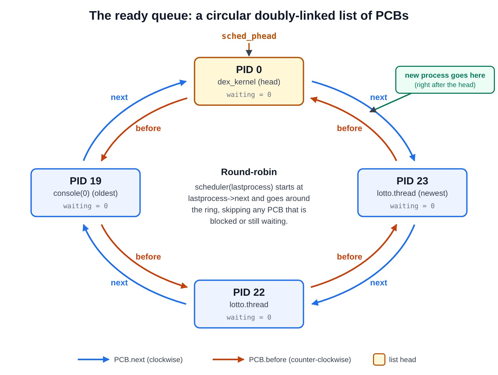

---
title: "CPU Scheduling in ICS-OS (Draft)"
author: [JAC Hermocilla]
date: "\\today"
subject: ""
keywords: cpu scheduling
header-left: "CMSC 125 | Operating Systems"
header-center: ""
header-right: "CPU Scheduling in ICS-OS" 
footer-left: "Revision: \\today "
footer-center: "\\thepage"
footer-right: "\\theauthor | ICS-UPLB"
titlepage: true
...


# CPU Scheduling in ICS-OS

## The problem: who gets the CPU?

A computer usually has one CPU (or a few) but many processes that all want to run (multiprogramming). The CPU can only run one process at a time, so the operating system rapidly switches between them — often hundreds of times per second. Each process runs for a tiny slice of time (a *quantum*, e.g. one timer tick), then the OS picks the next one.

The piece of the OS that does the picking is the **scheduler**, and the rule it uses for picking is the **scheduling policy/algorithm**.

## Round-robin

The simplest fair policy is **round-robin**: line the processes up in a circle and just go around — A, B, C, A, B, C, ... Everyone gets exactly one turn per cycle, so everyone gets an equal share of the CPU.

That's fair, but it's *rigid*. What if process A is a video encoder you want finished ASAP, and process B is a background file indexer you barely care about? Round-robin gives them 50/50 no matter what. There's no built-in way to say "A deserves more."

## Round-robin inside ICS-OS

ICS-OS ships with a round-robin scheduler. This section walks through how it works, because in the lab you will replace it with lottery scheduling. All paths are under `ics-os/kernel/`. Open the files as you read.

\newpage
### 1. Who calls the scheduler, and when

The scheduler does not run by itself. A hardware timer drives it (recall Limited Direct Execution discussion in the lecture):

```bash
 timer chip (PIT) raises IRQ 0 every 10 ms
          |
          v
 the CPU switches to the "scheduler" task          (IDT entry 0x20 is a task gate
          |                                          pointing at SCHED_TSS)
          v
 taskswitcher()                          process/process.c   (loops forever)
   1. readyprocess = scheduler(current_process)  <-- the POLICY, in process/scheduler.c
   2. current_process = readyprocess
   3. ps_switchto(readyprocess)           the CPU jumps into the chosen process
        ... the process runs until the next timer tick pulls the CPU back ...
   4. totalcputime++ for that process, update the clock, handle kill requests
   5. go back to step 1
```

Two things to notice:

- **Mechanism and policy are separate.** `taskswitcher()` is the mechanism: it performs the context switch. `scheduler()` is the policy: it only answers the question "who is next?" and returns a pointer to that process's control block. The lab changes the answer to that question.
- **ICS-OS uses the x86's built-in task switching.** Each process control block begins with a copy of the CPU's *task state segment* (the `regs` field below), so `ps_switchto()` can hand the CPU to a process with a single hardware task switch. The `taskswitcher` is itself a special task with PID 1. It is *not* on the list of runnable processes, which is why it never shows up in `ps`.

### 2. The time quantum

The quantum (the slice of CPU a process gets before the scheduler runs again) is **one timer tick**.

- `kernel32.c` sets `int context_switch_rate = 100;` and calls `dex32_set_timer(context_switch_rate)`.
- That programs the timer chip with a divisor of `1193180 / 100 = 11931`, which gives about 100 interrupts per second, so **one quantum is about 10 ms**.
- The quantum is the same for every process. There is no per-process time slice, and a process cannot ask for a longer one.
- The scheduler therefore makes at most 100 decisions per second. A process that does nothing but compute is preempted at the next tick whether it likes it or not.
- A process can *end its slice early* by calling `taskswitch()`, which raises the same interrupt (`int $0x20`) in software. This is similar to the `yield()` system call in linux. The kernel's `exit()` does this. These early hand-overs are not counted as clock ticks.
- The same tick drives the system clock: `time_handler()` is called from `taskswitcher()`, and the uptime that `ps` prints is `ticks / context_switch_rate`. That is why changing the rate changes more than the scheduling.

Each time a process comes back from its slice, `taskswitcher()` does `readyprocess->totalcputime++`. So `totalcputime` counts **slices**, not milliseconds. The `ps` command uses it, together with `lastcputime` (its value at the previous `ps`), to show how much CPU each process has used.

### 3. The process control block (PCB)

Every process and every thread is described by one `PCB386` structure (`process/process.h`). Only some fields matter to the scheduler:

| Field | Type | What it is, and what the scheduler does with it |
|---|---|---|
| `regs` | `saveregs` | The saved CPU state: EIP, ESP, general registers, segment registers, CR3 (the page directory). It is the **first** field on purpose, because the hardware task state segment points at the start of the PCB. |
| `regs2` | `FPUregs` | Saved floating-point state. `ps_switchto()` restores it before running the process and saves it afterwards. |
| `processid` | `DWORD` | The PID. `ps_findprocess(pid)` searches the queue for it. |
| `owner` | `DWORD` | The PID of the parent that created this process or thread. |
| `name` | `char[256]` | The name that `ps` prints. |
| `accesslevel` | `DWORD` | `ACCESS_SYS` (kernel) or `ACCESS_USER`. `ps_switchto()` uses it to choose which hardware task slot to switch through. |
| `priority` | `DWORD` | A priority value. **The round-robin scheduler never reads it.** You will reuse it as the ticket count. |
| `status` | `DWORD` | (aka processi/thread state) A set of flag bits: `PS_ATTB_LOCKED` (1), `PS_ATTB_UNLOADABLE` (2), `PS_ATTB_BLOCKED` (4), `PS_ATTB_THREAD` (8). The scheduler tests only `PS_ATTB_BLOCKED`. |
| `waiting` | `DWORD` | A countdown for a sleeping process. While it is non-zero the process is skipped. |
| `totalcputime`, `lastcputime` | `DWORD` | Slices used so far, and the value at the last `ps`. |
| `arrivaltime` | `DWORD` | When the process was created (the `AT` column of `ps`). |
| `next`, `before` | `PCB386 *` | The links that put this PCB in the ready queue (next section). |


### 4. The ready queue: a circular doubly-linked list

The scheduler needs to know which processes exist. ICS-OS keeps them all in one **circular doubly-linked list**, linked through the `next` and `before` fields of the PCBs. A global pointer, `sched_phead`, points at the head. In this kernel the head is the kernel's own process (PID 0, `dex_kernel`).




The list is *circular*: the last PCB's `next` points back at the head, so you can start anywhere and keep following `next` forever. That is what lets round-robin "go around".

The three operations are in `process/scheduler.c`:

- `sched_enqueue(process)`: a new process is inserted **right after the head**. The most recently created process is therefore first in line after PID 0, and the oldest is last.
- `sched_dequeue(process)`: unlink it by joining its neighbours: `ptr->before->next = ptr->next; ptr->next->before = ptr->before;`.
- `sched_findprocess(pid)`: walk the ring once, comparing `processid`.

Threads are treated the same way as processes. A thread created with `thread_create()` gets its own PCB and sits in the same ready queue as the other processes, so **the scheduler schedules PCBs**, and it neither knows nor cares whether a PCB is a "process" or a "thread". 

### 5. The algorithm: `scheduler()`

This is the entire round-robin policy. You will be rewriting it for the lottery scheduling lab.

```c
PCB386 *scheduler(PCB386 *lastprocess){
   PCB386 *ptr = lastprocess->next;

   //if this process is blocked or is waiting, we get another process.
   //This assumes that at least one process is not blocked or waiting.
   while ( (ptr->status & PS_ATTB_BLOCKED) || ptr->waiting ){
      ptr=ptr->next;
      if (ptr->waiting)
         ptr->waiting--;
   };

   //we should have picked a process at this point.
   return ptr;
};
```

How to read it:

1. `lastprocess` is `current_process`: the process that just used its slice.
2. **Start with the process right after it** in the ring (`lastprocess->next`). This single line is what makes the policy round-robin: the next decision always begins one step further around the ring.
3. If that candidate is blocked or still waiting, **skip it** and look at the following one. Keep going until a runnable process is found.
4. Return it. `taskswitcher()` then switches to it.

The loop has no stop condition other than finding a runnable process, so it relies on the comment's assumption that such a process always exists.

**A tiny trace.** Four processes in a ring `P1 -> P2 -> P3 -> P4 -> P1`, all runnable, with `P1` having just run:

| Tick | `lastprocess` | First candidate | Chosen |
|---|---|---|---|
| 1 | P1 | P2 | **P2** |
| 2 | P2 | P3 | **P3** |
| 3 | P3 | P4 | **P4** |
| 4 | P4 | P1 | **P1** |
| 5 | P1 | P2 | **P2** |

Everyone gets one slice per trip around the ring, so with *n* runnable processes each receives exactly 1/*n* of the CPU, in a fixed, predictable order.

Now let `P2` and `P3` both be asleep with `waiting = 2`, and again start after `P1`:

| Tick | `lastprocess` | What the loop does | Chosen | `waiting` of P2 / P3 afterwards |
|---|---|---|---|---|
| 1 | P1 | P2 is waiting, skip; step onto P3 and decrement it; P3 still waiting, skip; step onto P4 | **P4** | 2 / 1 |
| 2 | P4 | P1 is runnable | **P1** | 2 / 1 |
| 3 | P1 | P2 is waiting, skip; step onto P3 and decrement it; now 0, so P3 is runnable | **P3** | 2 / 0 |

Look at where the counters change. `waiting` is **not** driven by the clock. It is decremented only as a side effect of the scan, and only for a process the scan *steps onto* after skipping another. `P2`, which was the first candidate each time, was never decremented. Keep this in mind when you answer the tracing question about why the loop decrements `waiting`.

### 6. How a scheduler plugs into the kernel

`scheduler()` is not called directly. ICS-OS treats the scheduler as an *extension*: a table of function pointers (`devmgr_scheduler_extension` in `devmgr/dex32_devmgr.h`) with these entries:

| Entry | Round-robin implementation | Job |
|---|---|---|
| `scheduler` | `scheduler()` | choose the next process |
| `ps_enqueue` | `sched_enqueue()` | add a PCB to the ready queue |
| `ps_dequeue` | `sched_dequeue()` | remove a PCB |
| `ps_gethead` | `sched_gethead()` | return the head of the queue |
| `ps_findprocess` | `sched_findprocess()` | find a PCB by PID |
| `ps_listprocess` | `sched_listprocess()` | copy PCBs out for `ps` |

`ps_scheduler_install()` fills in this table and registers it as the current scheduler at startup, and `taskswitcher()` calls through it. In the lab you replace only the body of `scheduler()` and the descriptive strings. The queue, the context switch and the clock stay exactly as they are. 

For the lab, there is no need to dig deeper into this. What we will do is to simply modify the default scheduler, which uses round-robin, and add support for lottery scheduling.

### 7. Summary 

Putting it together: every runnable PCB gets one 10 ms slice per trip around the ring. The decision depends only on *position in the ring* and on whether a process is skippable. Nothing in it can express "this process is more important", and the `priority` field sits unused in every PCB. Lottery scheduling keeps the same plumbing and replaces "the next one in the ring" with "a random, ticket-weighted pick".

## The lottery idea

Lottery scheduling, invented by Carl Waldspurger and William Weihl in 1994, solves this with a beautifully simple idea:

> **Give each process some lottery tickets. Every time the CPU becomes free, hold a raffle. Whoever holds the winning ticket runs next.**

That's the whole algorithm. Concretely, each time the scheduler must pick:

1. Add up the tickets of all processes that are *ready to run* (not sleeping, not blocked waiting for input). Say the total is T.
2. Pick a random number `w` between 0 and T−1. That's the winning ticket.
3. Go down the list of ready processes, keeping a running sum of their tickets. The first process whose running sum passes `w` is the winner — it gets the CPU for this quantum.

## A worked example

Three ready processes:

| Process | Tickets | Ticket numbers held |
|---|---|---|
| A | 50 | 0–49 |
| B | 30 | 50–79 |
| C | 20 | 80–99 |

Total T = 100. The scheduler draws a random number from 0 to 99.

- Draw 37 → falls in 0–49 → **A wins** this quantum.
- Draw 65 → falls in 50–79 → **B wins**.
- Draw 91 → falls in 80–99 → **C wins**.

Each single draw is random — you cannot say who will win the *next* one. But probabilities are exact: A wins each draw with probability 50/100, B with 30/100, C with 20/100. Run the lottery 1,000 times and A will have won roughly 500 quanta, B roughly 300, C roughly 200. **CPU time is shared in proportion to tickets: 50% / 30% / 20%.**

That's why this is called a *proportional-share* scheduler. Tickets aren't vague "priority levels" — they are a precise statement of what fraction of the CPU a process should get: its tickets divided by the total.

## Additional implementation details for the lab

**How to generate random numbers?** The lottery requires a (pseudo) random number to select the winning ticket. You will need to add a function for this. Given in the lab.

**What about sleeping or blocked processes?** They don't participate. A process waiting for the disk or sleeping on a timer is skipped: its tickets are simply not counted in T this round, and they automatically count again the moment it wakes up. This means CPU shares are divided among the processes that actually *want* the CPU right now.

## Summary

| | Round-robin | Lottery |
|---|---|---|
| Who runs next? | The next one in the circle | A random ticket-weighted draw |
| Share of CPU | Equal for everyone | Proportional to tickets |
| Can you tune shares? | No | Yes — change ticket counts, even while running |
| Starvation possible? | No | No (every ticket has a chance) |
| Fairness guarantee | Exact, per cycle | Statistical, converges over many quanta |
| State needed | Just the queue | The queue + one ticket count per process + a PRNG |

In the lab you will replace the round-robin scheduler inside ICS-OS with this policy, use a provided console command to hand out tickets, and verify with real measurements that a thread holding 3× the tickets gets about 3× the CPU.

## Reference

C. A. Waldspurger and W. E. Weihl. *Lottery Scheduling: Flexible Proportional-Share Resource Management.* OSDI 1994 — short and very readable; the first four pages cover everything in this handout.
